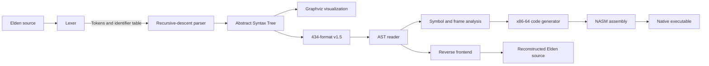

# Elden Language

An experimental C++ compiler toolchain for a custom, phrase-based programming language inspired by *Elden Ring*. It implements lexical analysis, recursive-descent parsing, an Abstract Syntax Tree (AST) interchange format, symbol and stack-frame analysis, reverse translation, and NASM x86-64 code generation.

## Overview

Elden Language translates themed source programs into native x86-64 assembly through separate frontend and backend stages. Its syntax replaces conventional keywords and operators with phrases: for example, `smelted with` denotes addition and `Bless thy tarnished with` denotes a return statement.

The frontend tokenizes source text, records identifiers, and constructs an AST using a handwritten recursive-descent parser. It serializes the tree into a textual interchange format. The backend restores this tree, assigns storage information to global variables, local variables, function parameters, and functions, then emits NASM assembly using scalar double-precision operations.

The repository also includes a reverse frontend that reconstructs Elden source from an AST, Graphviz-based tree visualization, and an earlier custom assembler and stack-processor implementation.

## Key Features

- Phrase-based lexical grammar defined through reusable C preprocessor tables.
- Handwritten recursive-descent parser with arithmetic precedence.
- Variables, assignments, conditional statements, functions, calls, parameters, returns, and recursion.
- Arithmetic expressions with addition, subtraction, multiplication, and division.
- Shared binary AST representation for statements, expressions, identifiers, and numeric values.
- Textual AST serialization separating parsing from backend code generation.
- Identifier metadata for global variables, local variables, function parameters, and stack-frame layout.
- Native NASM x86-64 generation using SSE2 scalar double-precision instructions.
- Reverse translation from the AST back into Elden source.
- Graphviz AST dumps and HTML indexes for compiler diagnostics.
- Factorial and quadratic-equation examples covering recursive calls, nested conditionals, and arithmetic expressions.

## Architecture



### Frontend

The lexer matches punctuation, identifiers, and multi-word tokens declared in `libs/DSL/DSL_elden.h`. Identifiers are interned in a shared table and represented in tokens by table indexes.

The parser maps the token stream into a binary AST. Separate parsing functions implement statement grammar and expression precedence:

```text
Expression  -> addition and subtraction
T           -> multiplication and division
POW         -> power-form expressions
Primary     -> variables, function calls, constants, and parentheses
```

Program statements are connected through `BOND` nodes. Function definitions contain a specification subtree and a body subtree, while calls carry the function identifier and argument expressions.

### AST Interchange

The frontend writes the AST using the repository-specific `434-format v1.5` representation. This creates an explicit boundary between parsing and code generation:

```text
{OP:"="
    {ID:"Michella"}
    {NUM:"4"}
}
```

The backend reads this format and rebuilds the operation, identifier, and numeric nodes. Variable definitions are encoded as zero-valued assignments during serialization and restored after loading.

### Middle-End Analysis

Before code generation, the middle-end traverses the AST to:

- distinguish functions from variables;
- count function parameters;
- assign global-variable storage;
- assign local-variable and parameter offsets;
- calculate the frame size required by each function.

Function calls use this metadata to prepare arguments and clear them from the stack after returning.

### Native Code Generation

The active backend emits NASM x86-64 assembly. Arithmetic expressions are evaluated recursively, with temporary double-precision values stored on the machine stack and loaded into SSE registers for each operation.

Global variables are emitted in the data section. Functions receive stack frames based on metadata computed by the middle-end. Calls, returns, conditional branches, printing, and assignment each have dedicated lowering functions.

A small assembly routine in `data/my_lib.asm` prints double-precision values without delegating number formatting to the generated program.

## Example

The included factorial program demonstrates variable declarations, a recursive function call, a conditional return, and arithmetic expressions:

```text
the ring of Michella forged;
And now the ring of Michella is pure golden needle;

the ring of Maliketh forged;
And now the ring of Maliketh is Letting thy grace of FACTORIAL
    shine upon the ring of Michella here;

In the age of Duskborn the ring of Maliketh
    will thunder in the darkest night;

The fallen leaves tell us a story of the FACTORIAL
    shine upon the ring of Tarnished
{
    And when the stars will fall along with
        the ring of Tarnished equal with Starling amber,
        bless them with
    {
        Bless thy tarnished with Starling amber;
    };

    the ring of Malenia forged;
    And now the ring of Malenia is
        the ring of Tarnished shadowed by Starling amber;

    And now the ring of Malenia is
        Letting thy grace of FACTORIAL
            shine upon the ring of Malenia here
        enchanted with the ring of Tarnished;

    Bless thy tarnished with the ring of Malenia;
};

$
```

The complete source is available in `data/factorial.txt`. A larger quadratic-equation example is provided in `data/sqsolver_elden.txt`.

## Repository Structure

```text
frontend/
|-- src/                 # Lexer, recursive-descent parser, and entry point
`-- headers/             # Frontend interfaces

backend/
|-- src/                 # Symbol analysis and x86-64 code generation
`-- headers/             # Backend and middle-end interfaces

libs/
|-- DSL/                 # Token, AST-operation, and tree-construction definitions
|-- headers/             # Shared AST, identifier-table, and file interfaces
|-- src/                 # Serialization, reverse frontend, and tree diagnostics
|-- my_stack/            # Stack implementation used by the legacy processor
`-- spu_headers/         # Legacy virtual instruction-set definitions

assembler/               # Assembler for the earlier custom stack machine
processor/               # Interpreter for custom stack-machine bytecode
data/                    # Source examples, serialized trees, and assembly output
pictures/                # Grammar and AST illustrations
```

## Getting Started

### Prerequisites

The main frontend and backend require:

- a C++ compiler available as `g++`;
- GNU Make;
- Graphviz `dot` for AST images.

The native assembly stage additionally requires:

- an x86-64 Linux environment;
- NASM;
- a C++ linker capable of linking ELF64 objects.

The legacy `assembler/` and `processor/` components include `TXLib.h` and have additional platform-specific requirements.

### Build and Run the Frontend

```bash
cd frontend
make compile
./build/elden_frontend
```

The program prompts for an input and output filename. Both are resolved relative to `../data/`. For the factorial example, enter:

```text
Enter file name for reading: factorial.txt
Enter file name for saving: factorial_tree_generated.txt
```

This stage also produces AST diagnostic files.

### Build and Run the Backend

```bash
cd ../backend
make compile
./build/elden_backend
```

The backend requests three filenames:

1. The serialized AST to read.
2. The NASM assembly file to generate.
3. The reverse-translated Elden source to generate.

For example:

```text
Enter file name for reading: factorial_tree_generated.txt
Enter file name for saving: factorial_generated.asm
Enter file name for saving: factorial_roundtrip.txt
```

### Assemble and Run Generated Code

The backend Makefile accepts the assembly basename through `ASM_FILE`:

```bash
make compile_asm ASM_FILE=factorial_generated
make run_asm ASM_FILE=factorial_generated
```

Object files and executables are written to the repository-level `bin_build/` directory.

## Technologies

- C++
- GNU Make
- NASM x86-64 assembly
- SSE2 scalar floating-point instructions
- Graphviz
- Linux System V ABI and ELF64 linking

## Current Status and Limitations

This repository is an experimental compiler implementation rather than a production language toolchain.

- Numeric source literals are limited to six themed constants representing values from zero through five.
- The lexer and identifier table use fixed capacities of 1,000 tokens and 128 identifiers.
- The parsed power operator is currently lowered as a square-root instruction rather than general exponentiation.
- The current `while` parser does not attach its grammar expression to the AST condition.
- Native input lowering is incomplete: the scanner calls `scanf`, but the generated path does not consistently load the scanned value from temporary storage.
- Syntax failures primarily terminate through assertions instead of structured diagnostics.
- The frontend and backend use interactive filenames and assume inputs reside in `data/`.
- Build and diagnostic paths contain a mixture of Windows and Linux conventions.
- No automated test suite or continuous-integration configuration is included.
- The custom assembler and stack processor represent an earlier execution path; the active backend emits native x86-64 assembly directly.
